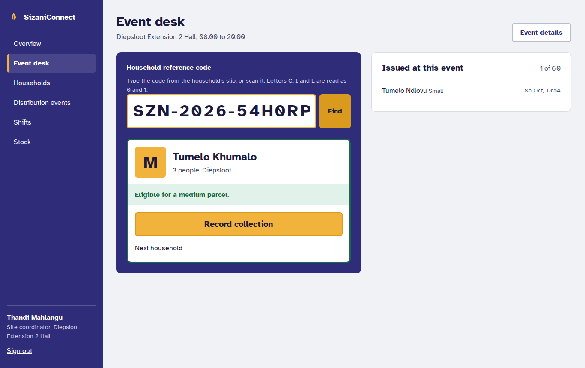
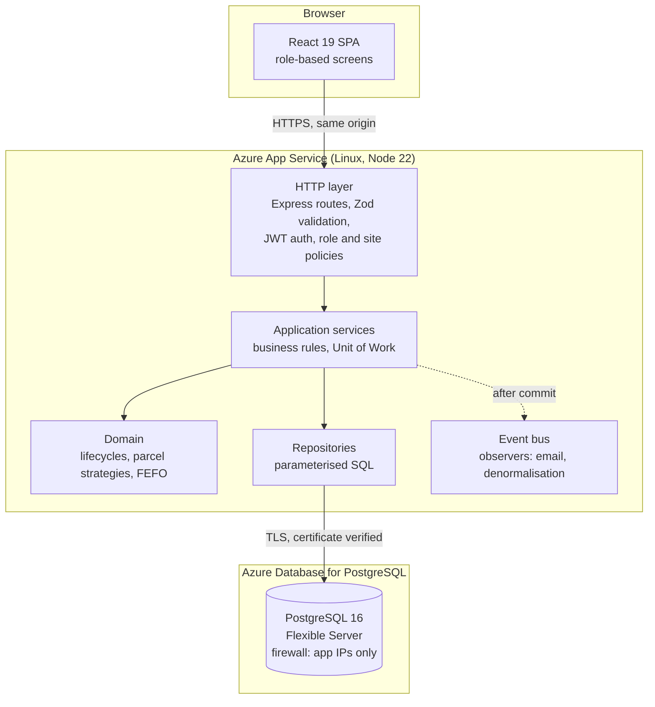
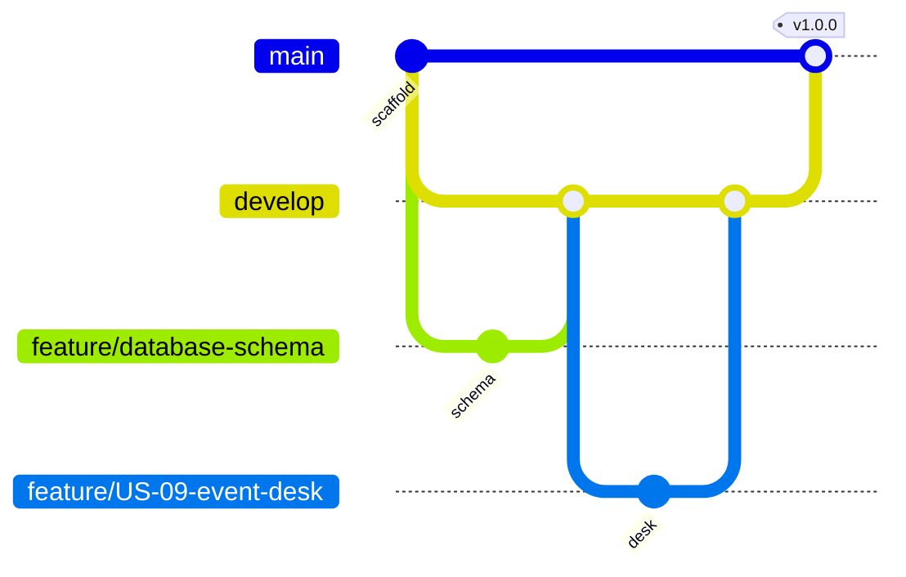

# SizaniConnect

Food relief operations for **Sizani Community Food Network NPC**, a Johannesburg non-profit running six distribution sites. SizaniConnect replaces paper registers, WhatsApp shift lists and delivery-note spreadsheets with one record: who is registered, what was issued to whom, which stock it came from, and who was on shift.

INSY7315 Information Systems 3E (WIL), Group 13, Task 2: Code and Implementation.



## What it does

| Role | What they use it for | User stories |
| --- | --- | --- |
| Site coordinator | Registers households, runs the event desk, opens, closes and reconciles distribution events at their own site, approves exceptional second parcels | US-01, 02, 04, 09, 10, 11 |
| Operations manager | Verifies households, schedules events, captures donations, manages stock and expiry, produces the monthly report | US-03, 05, 12, 13, 14, 15 |
| Volunteer | Signs up for shifts, withdraws, checks in, and records collections at the desk | US-06, 07, 08, 09 |
| Donor | Sees their donations, the households their goods reached, and printable receipts | US-16, 17 |
| Administrator | Creates accounts and roles, manages sites, reviews the audit trail | US-18, 19 |
| Everyone | Signs in, resets a forgotten password by email | US-20 |

The business rules from the Task 1 documentation are enforced in code and, where it matters most, by the database itself:

| Rule | Where it is enforced |
| --- | --- |
| BR-01 one live registration per person, across all sites | Keyed hash of the ID number, and a partial unique index on `households` |
| BR-02 only active households collect | `isEligibleForParcel` in the domain layer |
| BR-03 verification by an operations manager, and never by the person who registered the household | Role policy plus a four-eyes check in `HouseholdService` |
| BR-04 one parcel per household per event | Partial unique index on `collections (event_id, household_id)`, so it holds even when two phones submit at once |
| BR-05 parcel size by household size | Strategy classes in `domain/parcel.ts` |
| BR-06 first-expiry-first-out, never issue expired stock | `allocateFefo` in `domain/fefo.ts`, with row locks on the batches |
| BR-07 an event opens only once enough volunteers have checked in | `EventService.open` |
| BR-08 archive after 12 months without a collection | `POST /households/archive-inactive` |
| BR-09 every change to personal data is audited | `audit_log`, append-only by database trigger |
| BR-10 check-in opens 60 minutes before a shift | `ShiftService.checkIn` |

## Run it

### With Docker (quickest)

```bash
docker compose up --build
```

Open <http://localhost:8080>. The database is seeded with synthetic data: six sites, 42 households, stock with real expiry pressure, past events for reporting, and an event open today at Diepsloot.

### Without Docker

Needs Node 22 and PostgreSQL 16.

```bash
# API (http://localhost:8080)
cd api
cp .env.example .env          # point DATABASE_URL at your database
npm install
npm run dev                   # migrates and seeds on start

# Front end (http://localhost:5173, proxies /api to the API)
cd web
npm install
npm run dev
```

### Demo accounts

All use the password `Sizani-Demo-2026` (set by `SEED_DEMO_PASSWORD`).

| Email | Role | Try this |
| --- | --- | --- |
| `coordinator@sizani.test` | Site coordinator, Diepsloot | Event desk: record a collection, then try the same household again |
| `volunteer@sizani.test` | Volunteer | Shifts: check in to today's shift; sign up for an upcoming one |
| `ops@sizani.test` | Operations manager | Verify a pending household; write off the expired tea; September report |
| `donor@sizani.test` | Donor (Kopano Foods) | See which households the donated stock reached |
| `admin@sizani.test` | Administrator | Create a user; read the audit log |

## Architecture



Layered architecture, dependencies pointing inward, as designed in Task 1 Section 9.2. The front end is built into the API's `public/` folder and served from the same origin (see [Changes from Task 1](docs/CHANGES-FROM-TASK1.md)).

### Design patterns, and where to find them

| Pattern | Problem it solves here | Code |
| --- | --- | --- |
| Repository | Services query and persist without knowing SQL, so rules can be read in one place | `api/src/repositories/` |
| Unit of Work | A collection, its stock deductions and its audit entry commit together or not at all | `UnitOfWork` in `repositories/index.ts` |
| Strategy | Parcel sizing by household size changes with funding; a new rule is a new class | `domain/parcel.ts` |
| Factory method | One place defines the reference-code format and its collision retry | `domain/referenceCode.ts` |
| Observer | Recording a collection or a withdrawal triggers emails and updates without the service knowing about them | `events/eventBus.ts`, `container.ts` |
| Dependency injection | Tests swap the clock and mail sender without touching production code | `container.ts` (composition root) |
| State machine | Household and event lifecycles allow only the transitions in the Task 1 state diagrams | `domain/household.ts`, `domain/distributionEvent.ts` |
| Data Transfer Object | The identity hash and password hash never leave the API | `toPublicUser`, `lookupByReference` |

## Security

Mapped to the threat assessment in Task 1 Section 10.1.

| Threat | Control | Tested in |
| --- | --- | --- |
| T-01 credential stuffing | PBKDF2-SHA256 (600,000 iterations, per-user salt), lockout after 5 failures in 15 minutes, 10 sign-ins per minute per IP, 12-character minimum with a common-password list | `auth.test.ts` |
| T-02 cross-site scripting | Strict CSP with no inline script, React output encoding, lint rule banning `dangerouslySetInnerHTML` and `innerHTML`, server-side input validation, control-character stripping, HttpOnly cookies | `households.test.ts`, `auth.test.ts` |
| T-03 SQL injection | Parameterised queries only; a lint rule fails the build if a value is interpolated into SQL; LIKE wildcards escaped | `households.test.ts` |
| T-04 one user reading another's data | Resource-level checks: coordinators confined to their site, donors to their own records; another donor's receipt returns 404, not 403 | `supply-admin.test.ts`, `operations.test.ts` |
| T-05 privilege escalation | Deny-by-default role policies on every route | `auth.test.ts` |
| T-06 database disclosure | ID numbers stored only as an HMAC with a key kept outside the database; TLS with certificate verification to the database; database firewall admits only the web apps' outbound addresses | `households.test.ts` |
| T-08 cross-site request forgery | Bearer tokens for the API; the refresh cookie is SameSite=Strict, path-scoped, and its endpoints check `Origin` | `auth.test.ts` |
| T-10 denial of service | Every route sits behind a per-IP request ceiling (1,000 a minute, sized for a site sharing one mobile-data address); bodies capped at 100 KB; reports capped at one month; pagination capped at 100 | `rate-limit.test.ts` |
| T-09 repudiation | Append-only audit log enforced by a database trigger, recording who, what and when, but not personal values | `households.test.ts` |
| Session theft | 15-minute access tokens held only in memory; refresh tokens rotate on every use, and replaying an old one revokes the whole session family | `auth.test.ts` |
| T-11 vulnerable dependencies | `npm audit` gate in CI, CodeQL, Dependabot | CI |
| CSV injection | Report exports neutralise cells beginning with `=`, `+`, `-` or `@` | `operations.test.ts` |

POPIA: data minimisation (age bands rather than birth dates, no stored ID numbers), a minimal desk view that hides address and phone from volunteers, a subject-access export, and archiving after 12 months of inactivity.

## Tests

```bash
cd api && npm test            # 115 tests: unit + integration against real PostgreSQL
cd api && npm run test:coverage
cd web && npm test            # component tests for sign-in, role navigation and the event desk
```

API coverage of the domain, service and security layers is about 96% (the CI gate is 70%, NFR-18). Integration tests run the real HTTP pipeline against a fresh database per test file, including a race test where two devices record the same household at the same instant.

## Branching and CI/CD



- `main` is production; every release is tagged. `develop` is the integration branch. Work happens on `feature/US-xx-...` branches cut from `develop`, so each branch traces to a user story.
- **CI** (`.github/workflows/ci.yml`) runs on every push and pull request: lint (including the SQL and XSS rules), type checks, API tests against a PostgreSQL service container with the coverage gate, front-end tests and build, and a dependency audit.
- **Deploy** (`.github/workflows/deploy.yml`) reruns CI, builds one release package, deploys `develop` to the staging web app and `main` to production (behind an approval on the `production` environment), then smoke-tests `/api/v1/health` until it reports the deployed commit SHA and a live database.
- **CodeQL** scans every push to `develop` and `main`, and weekly.

## API

All routes are under `/api/v1`. Every route except sign-in, refresh, password reset and health needs a bearer token.

| Method and path | Who | Purpose |
| --- | --- | --- |
| `POST /auth/login`, `/auth/refresh`, `/auth/logout` | Anyone | Session handling |
| `POST /auth/forgot-password`, `/auth/reset-password` | Anyone | Reset and first-time activation |
| `GET /households`, `POST /households` | Staff | Search, register |
| `GET /households/by-ref/:code` | Desk roles | Minimal lookup for the event desk |
| `POST /households/:id/verify` and `/return`, `/resubmit`, `/suspend`, `/reinstate`, `/archive` | By role | Lifecycle |
| `GET /households/:id/export` | Ops, Admin | POPIA subject-access export |
| `GET /events`, `POST /events` | Staff, Ops | List, schedule |
| `POST /events/:id/stock`, `/open`, `/close`, `/reconcile`, `/cancel` | By role | Lifecycle |
| `POST /collections` | Desk roles | Record a parcel (with optional coordinator override) |
| `GET /shifts`, `GET /shifts/mine`, `POST /shifts` | Volunteers, coordinators | Shift board |
| `POST /shifts/:id/signup`, `/withdraw`, `/checkin` | Volunteers | Self-service |
| `GET /donors`, `POST /donors`, `GET /donations`, `POST /donations` | Ops | Donations |
| `GET /stock/items`, `/stock/alerts`, `POST /stock/batches/:id/write-off` | Ops, coordinators | Stock |
| `GET /reports/monthly`, `/reports/monthly.csv` | Ops, Admin | Monthly report |
| `GET /me/impact` | Donor | Donor portal |
| `GET /users`, `POST /users`, `GET /audit`, `GET/POST /sites` | Admin | Administration |
| `GET /health` | Anyone | Liveness, database check and deployed version |

Errors always have the shape `{ "error": { "code", "message", "details" } }`, and the message says what to do next.

## Project layout

```
api/
  migrations/           SQL migrations, applied at startup under an advisory lock
  src/domain/           business rules with no I/O
  src/repositories/     SQL, one class per aggregate, plus the Unit of Work
  src/services/         use cases: one service per area
  src/http/             routes, validation, auth and error middleware
  src/security/         password hashing, tokens, identity hashing
  tests/unit/           domain and security
  tests/integration/    the HTTP API against PostgreSQL
web/
  src/pages/            one file per area, screens S1 to S22 from the journey map
  src/components/       layout and the small UI kit
  src/lib/              API client, auth context, formatting
infra/azure-setup.sh    provisions the Azure resources (safe to re-run)
docs/                   deployment guide, changes from Task 1, presentation notes
```

## Documentation

- [Deploying to Azure](docs/DEPLOYMENT.md)
- [Changes from the Task 1 design](docs/CHANGES-FROM-TASK1.md)
- [Implementation presentation notes](docs/PRESENTATION.md)

The client, Sizani Community Food Network NPC, is a simulated case-study client, and every person, household and donor in the seed data is synthetic.
